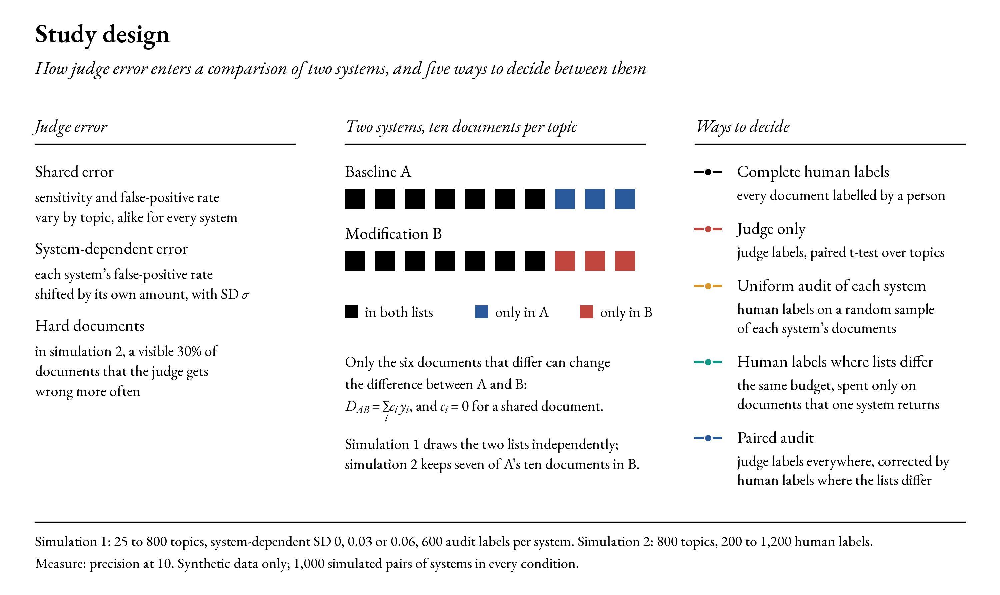
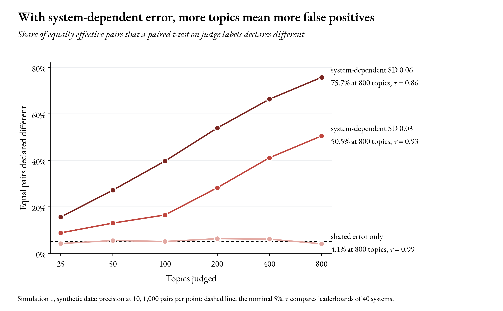
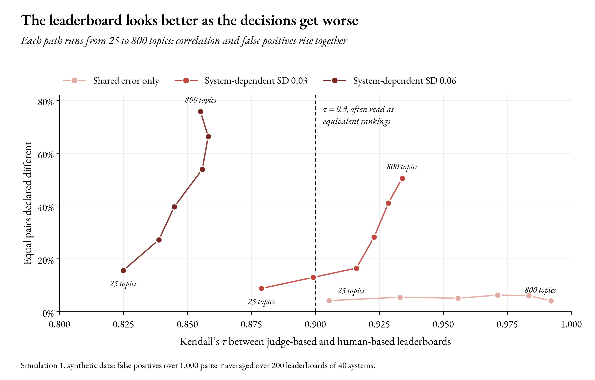
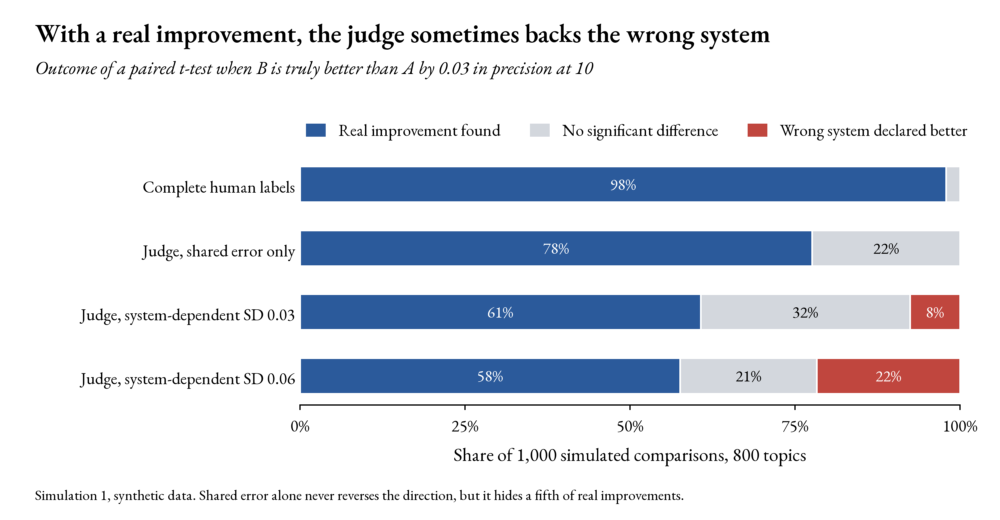
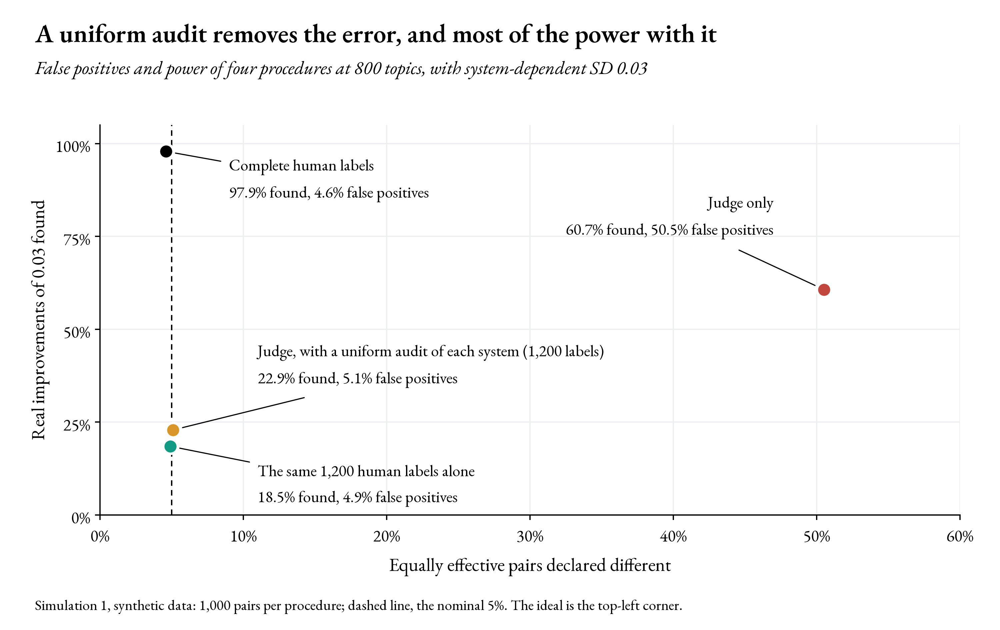
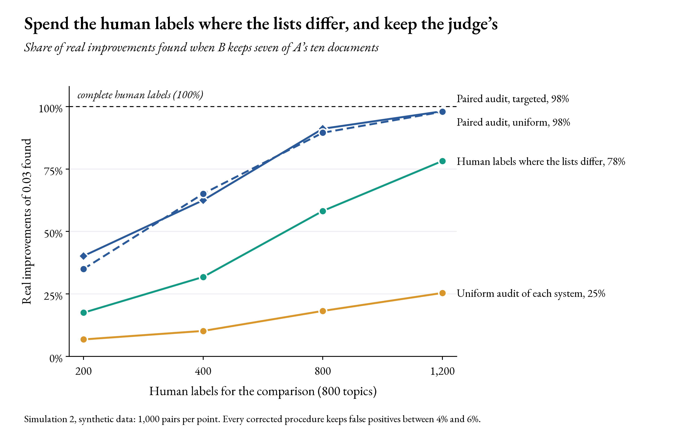
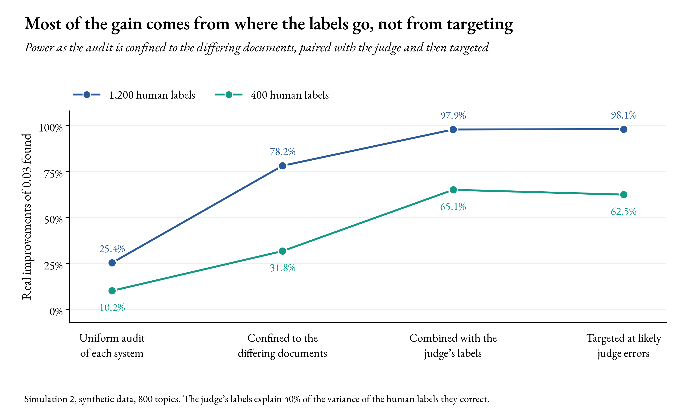

# Where Should the Human Labels Go? Simulating Targeted Audits of LLM Relevance Judges

<p align="center">
  
  
  
  
  
  
  
</p>

**Research context:** Reducing LLM-judge error in comparisons of retrieval systems </br>
**Study type:** Independent pre-doctoral simulation study </br>
**Data:** Synthetic relevance labels from two seeded simulations; no external data </br>

---

<p align="center">
  
</p>

## Abstract

Large language models now supply many of the relevance labels used to decide whether one search system beats another. A judge's mistakes cancel in such a comparison only if they are the same for both systems. I wanted to see what a small difference does, and how few human labels it takes to correct the comparison. In the first simulation, a judge whose false-positive rate varied between systems with a standard deviation of 0.03 made a paired t-test declare equally effective systems different in 8.8% of comparisons at 25 topics and in 50.5% at 800 topics, while Kendall's τ between its leaderboard and the human one rose from 0.88 to 0.93. With a standard deviation of 0.06, the judge named the wrong system as significantly better in 21.7% of comparisons where the other was truly better by 0.03. A uniform audit of 600 human labels per system brought false positives back to about 5% but found a real improvement in only 22.9% of comparisons. In the second simulation the modified system kept 7 of the baseline's 10 documents. The same 1,200 human labels found a real improvement in 25.4% of comparisons when spread over each system's documents, in 78.2% when confined to the documents that differ, and in 97.9% when also combined with the judge's labels through a difference estimator; every corrected procedure kept false positives between 4% and 6%. Sending the labels to documents the judge was likely to get wrong added little: 98.1% against 97.9% with 1,200 labels, and 62.5% against 65.1% with 400. All of this is synthetic. It illustrates a mechanism and the design of one part of a proposed doctoral project. The companion study, [`llm_judge_error`](https://github.com/iarminai/llm_judge_error), measures real judges on TREC Deep Learning 2023.

**Keywords:** information retrieval evaluation; LLM relevance judges; system-dependent error; paired significance tests; human audits; difference estimator; simulation.

---

## 1. Why this question

Progress in information retrieval (IR) is measured by comparing a modified system with a baseline on a test collection: a set of topics, the documents each system returns for them, and human judgements of which documents are relevant. Large language models (LLMs) are faster and cheaper than trained assessors and now provide many of these judgements (Faggioli et al., 2024; Thomas et al., 2024). An LLM judge is usually checked in two ways: by the rank correlation between its leaderboard and the human one (Kendall's τ), and by its agreement with human labels on single documents (Cohen's κ). TREC AutoJudge, a new task that compares LLM judges, uses both (Dietz et al., 2026). Neither check says whether a judge can decide a particular comparison.

Human assessors make mistakes too, but their mistakes rarely change which of two systems is better. An assessor does not know which system retrieved a document, so errors fall on both systems alike and cancel in their difference (Voorhees, 2000). An LLM judge is also blind to the system, but its errors can follow features of the documents that one system retrieves more often than another. LLM judges favour rankers built on LLMs (Balog et al., 2025) and over-rate non-relevant documents that repeat the words of the query (Alaofi et al., 2026). Error of this kind does not cancel. Measurement statistics calls it differential error (Keogh et al., 2020); here it is called system-dependent.

This repository asks two things about that error in a world where the truth is known. What does a small amount of it do to a paired significance test, and to τ? And if human labels are used to correct the comparison, where should they go? The answers motivate the targeted human audits of a proposed doctoral project on reducing LLM-judge error in comparisons of retrieval systems. The problem also has the structure of my work on exact confidence regions from an imperfect classifier and a small labelled sample (Hosseini, in press): an imperfect labeller, a few correct labels, and an error rate that has to hold.

---

## 2. Research questions

| | Question | Result that would count against the idea |
|---|---|---|
| Q1 | Does a small system-dependent error inflate the false-positive rate of a paired t-test on judge labels, and does the inflation grow with the number of topics? | False-positive rates near 5% at every number of topics |
| Q2 | Would leaderboard correlation reveal the problem? | τ falling as the false-positive rate rises |
| Q3 | Can a uniform human audit of each system remove the error without losing the power to find real improvements? | Power close to that of complete human labels |
| Q4 | When two systems share most of their documents, does a paired audit of the documents that differ recover that power, and does targeting likely judge errors add to it? | No gain over a uniform audit with the same budget |

---

## 3. Data

There are no external data. Two seeded simulations generate every label. Each simulated system returns ten documents per topic, each document is relevant or not, and the measure is precision at 10, the share of relevant documents among the ten. A judge labels each document with some sensitivity on the relevant ones and some false-positive rate on the others.

**Table 1. The two simulated worlds**

| Property | Simulation 1 | Simulation 2 |
|---|---|---|
| Topics | 25, 50, 100, 200, 400 or 800 | 800 |
| Pairs of systems per condition | 1,000 | 1,000 |
| Mean precision of a system | uniform between 0.30 and 0.60 | uniform between 0.30 and 0.55 |
| Topic effect on precision | normal, SD 0.15 | normal, SD 0.15 |
| Judge sensitivity | 0.85, varying by topic with SD 0.05 | 0.85, or 0.75 on hard documents, varying by topic with SD 0.05 |
| Judge false-positive rate | 0.15, varying by topic with SD 0.05 | 0.08, or 0.30 on hard documents, varying by topic with SD 0.05 |
| System-dependent error | each system's false-positive rate shifted by its own amount, SD 0, 0.03 or 0.06 | false-positive rate 0.10 higher on the documents that only B retrieves |
| Overlap of the two lists | none; the lists are drawn independently | B keeps 7 of A's 10 documents on every topic |
| Real improvement, for power | 0.03 | 0.03, carried by B's three new documents |
| Human budget | 600 labels per system | 200, 400, 800 or 1,200 labels per comparison |
| Seed | 20260917 | 20261029 |

In simulation 2, 30% of documents are hard, and an auditor can see which ones. That makes part of the judge's error predictable. The extra error on B's documents is not: nothing in the data flags it.

---

## 4. Methods

### 4.1 Why system-dependent error does not cancel

Write the judge's error on the score of system $s$ for topic $t$ as a part shared by every system on that topic, a part specific to the system, and noise: $e_{st} = \alpha_t + \beta_s + \varepsilon_{st}$. The judge-based difference between A and B on topic $t$ is then the human-based difference plus $(\beta_A - \beta_B) + (\varepsilon_{At} - \varepsilon_{Bt})$. The topic term cancels. The system term does not, and it is the same on every topic, so averaging over more topics shrinks the noise around it while leaving it in place. A paired t-test therefore grows more confident about a difference that the judge created as the number of topics grows. Shared error that is not a constant shift, such as a lower sensitivity, has a different effect: it shrinks real differences, so it hides improvements without inventing them.

### 4.2 Procedures

| Procedure | Human labels | Judge labels | Test |
|---|---|---|---|
| Complete human labels | every document | none | paired t-test over topics |
| Judge only | none | every document | paired t-test over topics |
| Uniform audit of each system | a random sample of each system's documents | every document | simulation 1: z-test on the corrected difference; simulation 2: paired t-test on per-topic estimates |
| Human labels alone (simulation 1) | the same budget, sampled the same way | none | Welch's t-test |
| Human labels where the lists differ (simulation 2) | a random sample of the six documents that differ | none | paired t-test on per-topic estimates |
| Paired audit, uniform (simulation 2) | a random sample of the documents that differ | every document | paired t-test on per-topic difference estimates |
| Paired audit, targeted (simulation 2) | the same, with half the budget sent to documents the judge is likely to get wrong | every document | paired t-test on per-topic difference estimates |

In simulation 2 every procedure gets the same budget and ends with a paired t-test over topics on its own per-topic estimate, so that both the sampling of topics and the sampling of documents for the audit enter the variance.

### 4.3 The difference estimator

For precision at 10, the difference between B and A is a weighted sum of labels, $D_{AB} = \sum_i c_i\, y_i$, where $c_i$ is item $i$'s weight in B's list minus its weight in A's: $+1/10$ for a document that only B returns, $-1/10$ for one that only A returns, and 0 for a shared one. With judge labels $\hat y_i$ on every item and human labels $y_i$ on a sample $S$ drawn with known inclusion probabilities $\pi_i$,

$$
\hat D_{AB} = \sum_i c_i\, \hat y_i + \sum_{i \in S} \frac{c_i\,(y_i - \hat y_i)}{\pi_i}
$$

is unbiased for $D_{AB}$ whatever errors the judge makes, provided every item with $c_i \neq 0$ has a positive chance of being sampled (Särndal et al., 1992). Shared documents never need a human label. The judge's labels work as a control variate: the more closely they track the human labels, the smaller the variance of the correction. The same idea underlies prediction-powered inference (Angelopoulos et al., 2023) and its active version, which chooses the items to label (Zrnic & Candès, 2024), and IR has long chosen which documents to judge so as to decide a comparison from human labels alone (Carterette et al., 2006; Moffat et al., 2007; Schnabel et al., 2016). What the paired audit adds is the combination of the two: judge labels everywhere, human labels only where the lists differ.

The targeted version sets $\pi_i$ in proportion to $|c_i|$ times the square root of the judge's predicted error probability on item $i$, and spends half the budget uniformly, because the error on B's documents is invisible to any predictor and a purely targeted sample would under-sample it.

### 4.4 What is measured

- **False positives:** the share of 1,000 pairs of equally effective systems that a procedure declares different, in either direction, at the 5% level.
- **Power:** the share of 1,000 pairs with a real improvement of 0.03 in which the procedure declares the better system significantly better. Claims in the wrong direction are counted separately.
- **Leaderboard correlation:** Kendall's τ between the judge-based and the human-based leaderboard of 40 systems with true precision from 0.15 to 0.75, averaged over 200 leaderboards.

---

## 5. Results

### 5.1 More topics, more false positives

<p align="center">
  
</p>

**Table 2. Equally effective pairs declared different by a paired t-test on judge labels, and Kendall's τ, by number of topics**

| Topics | Shared error only | SD 0.03 | SD 0.06 | τ, shared only | τ, SD 0.03 | τ, SD 0.06 |
|---:|---:|---:|---:|---:|---:|---:|
| 25 | 4.2% | 8.8% | 15.6% | 0.905 | 0.879 | 0.825 |
| 50 | 5.5% | 13.0% | 27.2% | 0.933 | 0.899 | 0.839 |
| 100 | 5.1% | 16.5% | 39.7% | 0.956 | 0.916 | 0.845 |
| 200 | 6.3% | 28.2% | 53.9% | 0.971 | 0.923 | 0.856 |
| 400 | 6.1% | 41.1% | 66.3% | 0.983 | 0.929 | 0.858 |
| 800 | 4.1% | 50.5% | 75.7% | 0.992 | 0.934 | 0.855 |

With shared error only, the test keeps close to its nominal rate at every size. With a system-dependent SD of 0.03, the false-positive rate climbs from 8.8% at 25 topics to 50.5% at 800. With 0.06 it climbs from 15.6% to 75.7%. These are not large errors. At an SD of 0.03, the typical gap between two systems' false-positive rates is about 0.04: four extra documents called relevant per hundred non-relevant ones.

### 5.2 The leaderboard looks better as the decisions get worse

<p align="center">
  
</p>

More topics make each system's score more precise, so the judge's leaderboard agrees more closely with the human one even when the judge is biased. At an SD of 0.03, τ rises from 0.88 at 25 topics to 0.93 at 800. It passes 0.9, the value often read as equivalent rankings (Voorhees, 2000), between 50 and 100 topics; at 100 topics the false-positive rate is already 16.5%. A judge validated by τ alone would look better on larger collections while its paired decisions got worse.

### 5.3 With a real improvement, the judge can back the wrong system

<p align="center">
  
</p>

With a real improvement of 0.03 and 800 topics, complete human labels found it in 97.9% of comparisons. A judge with shared error only found it in 77.6% and never reversed it: missing some relevant documents and accepting some non-relevant ones shrank the difference without biasing its sign. With system-dependent error, the judge found the improvement less often and sometimes declared the worse system significantly better, in 7.6% of comparisons at an SD of 0.03 and in 21.7% at 0.06.

### 5.4 A uniform audit removes the error, and most of the power with it

<p align="center">
  
</p>

The obvious correction is to audit each system: label a random sample of its documents by hand, estimate how far its judge-based score is off, and subtract. With 600 labels per system this works for validity. At an SD of 0.06 and 800 topics it brought the false-positive rate down from 75.7% to 4.7%. It does not work for power. At an SD of 0.03 the audited comparison found a real improvement in 22.9% of comparisons, little more than the 18.5% found by the same 1,200 human labels used without the judge, against 97.9% for complete labels. Each audit samples 600 of a system's 8,000 documents and adds the noise of that sample to a difference that pairing had made precise. At 25 and 50 topics the audit covers every document and its variance estimate ignores the covariance between the judge-based difference and the correction, so the corrected test is conservative there, with 1% to 2% false positives.

### 5.5 Human labels where the lists differ, combined with the judge's

<p align="center">
  
</p>

**Table 3. Simulation 2: real improvements found (power) and equally effective pairs declared different (false positives), by number of human labels**

| Procedure | Power, 200 | Power, 400 | Power, 800 | Power, 1,200 | False positives, range over budgets |
|---|---:|---:|---:|---:|---|
| Complete human labels | 100% | 100% | 100% | 100% | 4.4%–5.6% |
| Judge only | 100% | 100% | 100% | 100% | 96.4%–97.2% |
| Uniform audit of each system | 6.8% | 10.2% | 18.2% | 25.4% | 4.1%–5.8% |
| Human labels where the lists differ | 17.5% | 31.8% | 58.2% | 78.2% | 4.6%–5.4% |
| Paired audit, uniform | 35.0% | 65.1% | 89.5% | 97.9% | 4.5%–5.2% |
| Paired audit, targeted | 40.2% | 62.5% | 91.1% | 98.1% | 4.7%–5.4% |

The judge alone "finds" every improvement only because it over-rates B's documents: it also calls 97% of equally effective pairs different. Every corrected procedure kept its false-positive rate between 4% and 6%. Among them, spending the labels on the documents that differ more than tripled the power of the uniform audit at 1,200 labels, and combining those labels with the judge's brought the comparison close to what complete human labels achieve.

### 5.6 Where the gain comes from

<p align="center">
  
</p>

Taking the changes one at a time shows which of them matters. Confining the labels to the documents that differ lifted power from 25.4% to 78.2% at 1,200 labels. Adding the judge's labels as a control variate lifted it to 97.9%. Targeting the judge's likely errors then changed little: 98.1% at 1,200 labels, 62.5% against 65.1% at 400, and 40.2% against 35.0% at 200. The reason is in the numbers. On the differing documents the judge's labels explain 40% of the variance of the human labels. With uniform sampling, a control variate of that strength can raise the effective number of human labels by at most about 1.7 times, and the remaining error varies too little from item to item for targeting to buy much more. Whether real judges, whose errors are more uneven, leave more room for targeting is an empirical question.

---

## 6. What is established, what is new, and what is left

| | |
|---|---|
| **Established methods** | Paired significance tests for IR experiments (Smucker et al., 2007); the difference estimator of model-assisted survey sampling (Särndal et al., 1992); prediction-powered and active inference (Angelopoulos et al., 2023; Zrnic & Candès, 2024); choosing which documents to judge in order to decide a comparison (Carterette et al., 2006; Moffat et al., 2007; Schnabel et al., 2016); differential measurement error (Keogh et al., 2020). |
| **What this study adds** | A demonstration, with known ground truth, that a small system-dependent error turns more topics into more false positives while τ improves; that a uniform audit of each system restores validity but not power; and that a paired audit of the documents where two lists differ, with the judge's labels as a control variate, recovers almost all of the power of complete labels with 1,200 human labels, while targeting likely errors adds little in this setting. |
| **Left for doctoral research** | Real judges, whose errors are more uneven (the companion study measures them on TREC Deep Learning 2023); predicting a judge's errors item by item; measures with position weights, such as nDCG; stopping rules that end the labelling once a comparison is decided, using anytime-valid confidence sequences (Waudby-Smith & Ramdas, 2024); and leaderboards rather than pairs. |

---

## 7. Limitations

- **A synthetic world.** Every number describes the simulated judge and systems. The simulations show a mechanism and compare designs; they do not estimate how large system-dependent error is for any real judge.
- **One kind of system-dependent error.** The judge's false-positive rate shifts by system. Real judges can also differ in sensitivity, over-grade documents that repeat the query, or prefer text from their own model family, and these errors need not be constant across topics.
- **Precision at 10 only.** The difference estimator applies directly to measures that are weighted sums of labels. Measures such as nDCG are ratios and need a linearisation.
- **Fixed budgets.** Every audit spends a budget fixed in advance. An audit that stops as soon as the comparison is decided could spend far fewer labels on easy comparisons.
- **A weak predictor of judge error.** Targeting uses one visible feature. With a better predictor, or a judge whose errors cluster more, targeting could matter more than it did here.

---

## 8. Reproducing the analysis

The notebook is the full analysis. Running it from top to bottom runs both simulations and writes every figure in `figures/`. It took under a minute on a laptop.

```python
ALPHA = 0.05            # level of every significance test
K = 10                  # evaluation depth: precision at 10
N_PAIRS = 1000          # simulated pairs of systems per condition
SEED_1 = 20260917       # simulation 1: judge error and paired tests
SEED_2 = 20261029       # simulation 2: paired audits
```

| Reproducibility control | Status |
|---|---|
| Data | None; every label is simulated |
| Randomness | One seeded generator per simulation, used in a fixed order |
| Checks | Each corrected procedure is also run on equally effective pairs, so its false-positive rate is measured, not assumed |
| Figures | Generated by the notebook in EB Garamond (SIL Open Font Licence), downloaded on first run |
| Software | Python 3.12 with NumPy, pandas, SciPy and matplotlib; exact versions are printed by the notebook |

```bash
pip install numpy pandas scipy matplotlib jupyter
jupyter nbconvert --to notebook --execute --inplace notebook.ipynb
```

---

## References

Alaofi, M., Thomas, P., Scholer, F., & Sanderson, M. (2026). On the use of LLMs for relevance labelling. *ACM Transactions on Information Systems, 44*(4), 1–31. https://doi.org/10.1145/3788872

Angelopoulos, A. N., Bates, S., Fannjiang, C., Jordan, M. I., & Zrnic, T. (2023). Prediction-powered inference. *Science, 382*(6671), 669–674. https://doi.org/10.1126/science.adi6000

Balog, K., Metzler, D., & Qin, Z. (2025). Rankers, judges, and assistants: Towards understanding the interplay of LLMs in information retrieval evaluation. In *Proceedings of the 48th International ACM SIGIR Conference on Research and Development in Information Retrieval* (pp. 3865–3875). https://doi.org/10.1145/3726302.3730348

Carterette, B., Allan, J., & Sitaraman, R. (2006). Minimal test collections for retrieval evaluation. In *Proceedings of the 29th Annual International ACM SIGIR Conference on Research and Development in Information Retrieval* (pp. 268–275). https://doi.org/10.1145/1148170.1148219

Dietz, L., Farzi, N., Yang, E., & Zendel, O. (2026). *TREC AutoJudge: Cross-track comparison of LLM judges* [Track guidelines and starter kit]. Text REtrieval Conference. https://trec-auto-judge.cs.unh.edu/

Faggioli, G., Dietz, L., Clarke, C. L. A., Demartini, G., Hagen, M., Hauff, C., Kando, N., Kanoulas, E., Potthast, M., Stein, B., & Wachsmuth, H. (2024). Who determines what is relevant? Humans or AI? Why not both? *Communications of the ACM, 67*(4), 31–34. https://doi.org/10.1145/3624730

Hosseini, S. A. (in press). Exact prevalence regions: Finite-sample uncertainty quantification, threshold decisions, and monitoring for class-prevalence analytics under prior probability shift. *International Journal of Data Science and Analytics*. Accepted 23 October 2026.

Keogh, R. H., Shaw, P. A., Gustafson, P., Carroll, R. J., Deffner, V., Dodd, K. W., Küchenhoff, H., Tooze, J. A., Wallace, M. P., Kipnis, V., & Freedman, L. S. (2020). STRATOS guidance document on measurement error and misclassification of variables in observational epidemiology: Part 1. Basic theory and simple methods of adjustment. *Statistics in Medicine, 39*(16), 2197–2231. https://doi.org/10.1002/sim.8532

Moffat, A., Webber, W., & Zobel, J. (2007). Strategic system comparisons via targeted relevance judgments. In *Proceedings of the 30th Annual International ACM SIGIR Conference on Research and Development in Information Retrieval* (pp. 375–382). https://doi.org/10.1145/1277741.1277806

Särndal, C.-E., Swensson, B., & Wretman, J. (1992). *Model assisted survey sampling*. Springer.

Schnabel, T., Swaminathan, A., Frazier, P. I., & Joachims, T. (2016). Unbiased comparative evaluation of ranking functions. In *Proceedings of the 2016 ACM International Conference on the Theory of Information Retrieval* (pp. 109–118). https://doi.org/10.1145/2970398.2970410

Smucker, M. D., Allan, J., & Carterette, B. (2007). A comparison of statistical significance tests for information retrieval evaluation. In *Proceedings of the 16th ACM Conference on Information and Knowledge Management* (pp. 623–632). https://doi.org/10.1145/1321440.1321528

Thomas, P., Spielman, S., Craswell, N., & Mitra, B. (2024). Large language models can accurately predict searcher preferences. In *Proceedings of the 47th International ACM SIGIR Conference on Research and Development in Information Retrieval* (pp. 1930–1940). https://doi.org/10.1145/3626772.3657707

Voorhees, E. M. (2000). Variations in relevance judgments and the measurement of retrieval effectiveness. *Information Processing & Management, 36*(5), 697–716. https://doi.org/10.1016/S0306-4573(00)00010-8

Waudby-Smith, I., & Ramdas, A. (2024). Estimating means of bounded random variables by betting. *Journal of the Royal Statistical Society Series B: Statistical Methodology, 86*(1), 1–27. https://doi.org/10.1093/jrsssb/qkad009

Zrnic, T., & Candès, E. J. (2024). Active statistical inference. In *Proceedings of the 41st International Conference on Machine Learning* (PMLR Vol. 235, pp. 62993–63010). https://proceedings.mlr.press/v235/zrnic24a.html

---

## Licence

This repository uses a dual-licence structure:

- Code, notebooks, scripts, configuration files, executable components, and original software materials are licensed under the MIT Licence. See `LICENSE.md`.
- README text, documentation, research explanations, methodological descriptions, diagrams, tables, figures, and other written or visual materials are licensed under the Creative Commons Attribution-NonCommercial 4.0 International Licence (CC BY-NC 4.0). See `LICENSE.md`.

Third-party libraries, package dependencies, academic papers, badges, fonts and source materials remain subject to their own licences and terms of use. No external data are used; every label in this repository is simulated. This repository does not relicense third-party materials.
